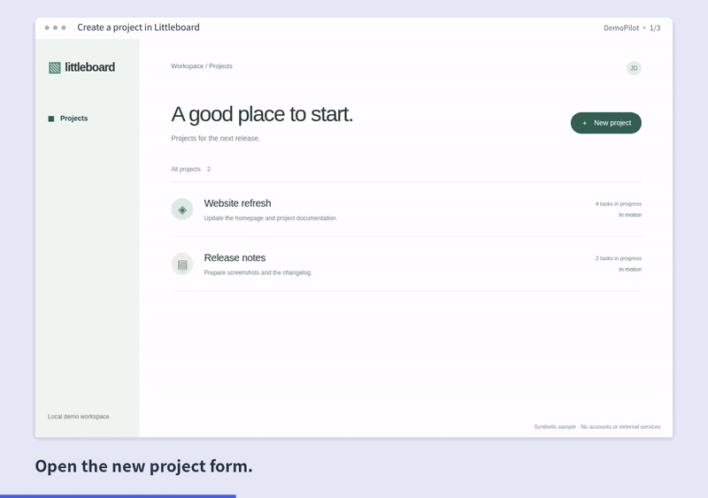
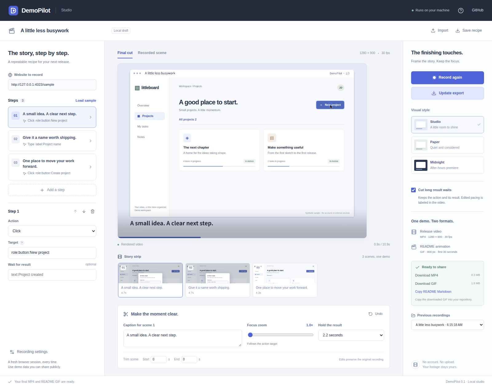

<p align="center"></p>
<h1 align="center">DemoPilot</h1>
<p align="center">Your project changed. Your demo can keep up.</p>
<p align="center">Repeatable browser workflows → real recordings → editable MP4 and GIF.</p>
<p align="center"><a href="https://github.com/Ray0766/demopilot/actions/workflows/ci.yml"></a> <a href="LICENSE"></a> <a href="docs/README.zh-CN.md">简体中文</a></p>



[Watch DemoPilot record and edit its own demo](docs/media/showcase.mp4) · [Download the latest release](https://github.com/Ray0766/demopilot/releases/latest)

**DemoPilot is a local recording and editing studio for developers shipping browser apps.** Give it a URL and explicit steps. It operates Chromium, records the real page, and turns the footage into a release video and a short README animation. Save the recipe alongside your code and record it again when the app changes.

**v0.2.0:** edit a scene's caption, timing and camera in a live preview; reuse unchanged scenes when exporting; follow the explicitly recorded result. Long captions fit through real font layout or report an actionable error instead of losing text. No account, model API, telemetry or cloud upload. Chromium and FFmpeg run on your machine. The website being recorded can still make its own network requests.

## Try it

Requires **Node.js 22+**, **FFmpeg with libx264** and **ffprobe** on PATH. On Windows, install FFmpeg from a build linked by [ffmpeg.org](https://ffmpeg.org/download.html), then reopen the terminal. macOS: `brew install ffmpeg`. Ubuntu/Debian: `sudo apt-get install ffmpeg`. Set `FFMPEG_PATH` and `FFPROBE_PATH` if they are installed elsewhere.

```bash
git clone https://github.com/Ray0766/demopilot.git
cd demopilot
npm ci
npx playwright install chromium
npm run build
npm run doctor
npm start
```

Open **http://127.0.0.1:4310**. The included Littleboard sample uses synthetic data and needs no login:

1. Click **Record demo**. Watch three steps run in a fresh browser.
2. Select a scene. Edit its caption in **Script** and inspect **Edit preview** immediately. Open **Timing & zoom** for hold, trims and camera focus. Choose a template in **Frame & export**.
3. Click **Export MP4 + GIF**. Preview the actual export and download both files.

Want to skip the editor? `npm run demo` starts its own sample server, records the workflow, and writes `output/demo/demo.mp4` and `output/demo/demo.gif`.

On Linux, use `npx playwright install --with-deps chromium` if browser system libraries are missing. [Troubleshooting](docs/USAGE.md#troubleshooting) covers ports, selectors, fonts and FFmpeg.

## Record again, keep the edit



- **Explicit steps:** click, fill, press, scroll, hover, select, navigate and wait for a visible target. Semantic targets and CSS selectors use Playwright's waiting and actionability checks.
- **Editable footage:** captions, eased camera focus, result holds and start/end trims can change without opening the website again. Original source clips stay intact.
- **Immediate scene preview:** captions use the same rendered frame as export; timing and crop share one composition plan. Play or scrub the selected scene before exporting.
- **Incremental export:** content-checked scene caching reuses unchanged clips. Changing one caption rebuilds that scene; joining and GIF creation still run.
- **Result-following camera:** a visible `waitFor` result supplies the destination rectangle. The camera eases from the action to that result, with target/center overrides and viewport bounds. Older takes without result positions keep action focus.
- **Repeatable recipes:** stable step IDs connect the workflow to each captured scene. A changed action, URL or viewport requires a new recording, so old footage cannot silently represent a new workflow.
- **Three visual styles:** Studio, Paper and Midnight. Captions sit outside the website; they do not cover its controls.
- **Two outputs:** a 1280 × 900 H.264 MP4 at 30 fps, plus an 800 px GIF at 12 fps containing the first 30 seconds. GIFs use an optimized palette and loop.
- **Honest pacing:** optional trimming removes the middle of long explicit result waits while retaining the action and result. The export labels edited pacing. These videos are presentations, not performance benchmarks.
- **Local by design:** recipes and footage remain on disk. Failed or cancelled jobs remove their partial recording/export instead of showing a successful result.

**Edit preview** shows the current selected scene's presentation without encoding a new video. **Recorded scene** shows its original footage. **Final cut** plays the most recent exported MP4; pending edits are labeled until you export again. Native preview decoding/scaling can differ slightly from encoded pixels; review Final cut before publishing.

## Use your own app

Start your app first, then change the website URL and steps. Give controls accessible labels or stable test IDs:

```json
{
  "version": 1,
  "title": "A new project in three steps",
  "url": "http://localhost:3000",
  "template": "studio",
  "steps": [
    { "id": "open", "action": "click", "target": "role:button:New project", "caption": "Open the new project form." },
    { "id": "name", "action": "fill", "target": "label:Project name", "value": "My next release", "caption": "Enter a project name.", "zoom": 1.3 },
    { "id": "save", "action": "click", "target": "testid:create-project", "waitFor": "text:My next release", "caption": "Find the new project on the board." }
  ]
}
```

Save as `demo.recipe.json`. The CLI uses the same capture and rendering pipeline as Studio:

```bash
# Create a starter recipe (will not overwrite an existing file)
node dist/server/cli.js init

# Record your running app and export both formats
node dist/server/cli.js record demo.recipe.json --output output/my-demo

# Edit captions/zoom/holds/trims in the JSON, then render the existing recording
node dist/server/cli.js render <recording-id> demo.recipe.json --output output/revised
```

Recording IDs are printed in the terminal. Recordings live in `.demopilot/recordings/`; exports in `.demopilot/exports/`, relative to your current directory. Studio restores the selected recording, its draft and last export after reload. Each recording keeps its own edits when you switch takes. Unexported changes remain labeled as pending. Drafts use browser storage for the same Studio address; download the recipe before clearing storage or changing browsers/ports.

For a GitHub README, copy the GIF into your repository and add:

```markdown

```

[Full recipe reference and CLI](docs/USAGE.md) · [Chinese guide](docs/README.zh-CN.md) · [Current validation](docs/VALIDATION-v0.2.0.md) · [UI references and design](docs/UI-COMPOSITION.md) · [Technical decisions](docs/DECISIONS.md)

## Boundaries of this release

One Chromium tab, explicit steps, no recorded audio, webcam or desktop apps. Fresh sessions do not reuse your browser cookies. Popups and unexpected dialogs fail the run; CAPTCHAs, login automation, iframes, file uploads and natural-language planning are outside this release. Use an isolated demo account or a signed-out synthetic app, not production data. Password fields cannot be filled by the recorder; this is **not** automatic redaction of sensitive information already visible on a page.

Target preparation (finding a visible element and scrolling it into view) happens before each clip. Its duration is recorded separately. Post-action waiting is retained in source footage; the trimming switch affects only explicit result waits. Rendered holds may repeat the last frame. Do not interpret the final video as an unedited measurement of app speed.

Maximums: 40 steps, 1920 × 1080 capture viewport, 60-second action timeout, one active job, 10-minute Studio job limit. Stored successful recordings are not automatically deleted. Close Studio before manually removing unneeded `.demopilot` data. No external telemetry; no automatic upload or publishing of your recordings.

## Develop and contribute

```bash
npm run dev        # Studio with Vite, port 4310
npm run check      # TypeScript
npm test           # validation, timeline, identity and cancellation checks
npm run build
npm run test:e2e   # real browser recordings, editing, exports and UI
npm run test:recovery # reload, switch takes, restart and missing-file recovery
```

See [CONTRIBUTING.md](CONTRIBUTING.md), [SECURITY.md](SECURITY.md) and [THIRD_PARTY_NOTICES.md](THIRD_PARTY_NOTICES.md). New issues should include a small synthetic recipe, expected behavior and tool versions. The repeatable workflow is the priority; this is not a general-purpose video editor.

MIT © Ray0766. FFmpeg, browsers, fonts and dependencies retain their own licenses. Development guidance lives in [AGENTS.md](AGENTS.md) and [the quality brief](docs/QUALITY_BRIEF.md).
