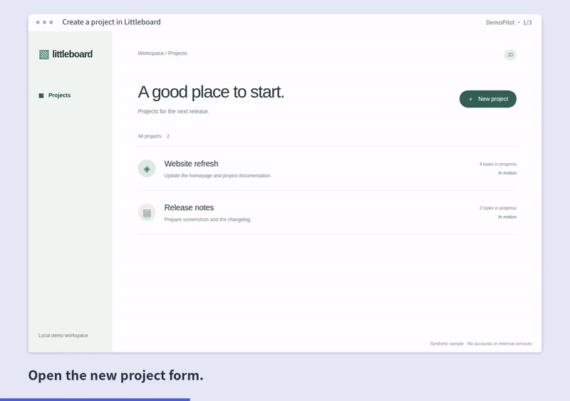

# DemoPilot

输入网站地址和明确步骤，自动操作浏览器，生成可编辑的项目演示视频与 README 动图。**首版已实现本地 Studio 和 CLI**，无需账号、模型密钥或云端上传。



## 开始使用

先安装 Node.js 22+、FFmpeg（带 libx264）和 ffprobe，并加入 PATH。

```bash
git clone https://github.com/Ray0766/demopilot.git
cd demopilot
npm ci
npx playwright install chromium
npm run build
npm run doctor
npm start
```

打开 `http://127.0.0.1:4310`。默认提供虚构数据的 Littleboard 示例，点 **Record demo** 录制三步流程；在 **Edit preview** 即时查看当前场景的字幕、镜头、停留和首尾裁剪，再点 **Export MP4 + GIF**。**Final cut** 播放实际导出文件。

v0.2.0 沿用明亮的品牌工作台：顶部是项目标题，底部 **The sequence** 横向排列步骤。选中场景后，在画面旁的 **Script** 编辑字幕；**Action & target** 展开操作目标，**Timing & zoom** 展开停留、缩放、镜头焦点和裁剪，**Frame & export** 选择模板。展示字体和正文字体均本地打包。[设计参考与取舍](UI-COMPOSITION.md)

也可直接执行 `npm run demo`，自动启动示例并输出到 `output/demo/`。

## 核心用途：更新项目时重新拍摄

把 JSON 配方随项目代码保存。每个步骤都有稳定 ID，关联真实录像、字幕、焦点和剪辑。改字幕、模板、缩放或节奏无需重新打开网站；更改操作、网址或窗口大小则必须复录，避免旧画面被误当成新流程。

- Playwright 自动等待、语义定位与真实 Chromium 录制。
- 点击、填入、按键、滚动、悬停、选择、导航、等待可见目标。
- Studio / Paper / Midnight 三种模板，字幕不盖住网页内容。
- 字幕使用真实字体排版，预览和导出复用同一字幕画面；超出可读排版范围时明确报错，不静默截断。
- 当前场景可即时预览；未变场景在导出时从校验过的缓存复用，改一句字幕只重做对应场景。最终拼接和 GIF 仍需生成。
- 镜头可从操作位置平滑移向明确的 `waitFor` 结果，也可固定在操作目标或页面中央。旧录像没有结果位置时回退到操作目标。
- MP4：1280 × 900，恒定 30 fps；GIF：800 px、12 fps、前 30 秒。
- 长结果等待可剪短，成片会标记经过节奏编辑，不能据此推断真实响应速度。
- 原始片段与导出保存在本机 `.demopilot/`；失败或取消的任务清理未完成结果。

首版只支持单标签浏览器应用，无音频、摄像头、桌面录制、自动登录或自然语言规划。使用隔离演示数据；密码字段禁止填入，但不会自动遮盖网页上已有的敏感内容。

## CLI

```bash
node dist/server/cli.js init
node dist/server/cli.js record demo.recipe.json --output output/my-demo
node dist/server/cli.js render <recording-id> demo.recipe.json --output output/revised
```

录制 ID 会打印在终端。可从 Studio 导入/下载配方、打开历史录制。v0.1.1 会在刷新页面或重启 Studio 后恢复当前录制、编辑草稿和上次导出，切换历史录制也会保留各自编辑。未导出的修改会继续标为待导出。源素材缺失时明确要求复录，不自动替换成别的录像。

草稿保存在同一浏览器、同一 Studio 地址（含端口）的本地存储；清除浏览器存储、换浏览器或跨机器前请下载配方。正在运行的任务和撤销历史不会在刷新后恢复。

目标示例：`role:button:New project`、`label:Project name`、`text:Project created`、`testid:save-button` 或 CSS `#save`。异步操作通过 `waitFor` 指定结果元素；不以猜测的固定延迟代替状态判断。

把 GIF 放入项目 `docs/demo.gif`，README 中写入：

```markdown

```

[完整配方与排错](USAGE.md) · [当前验证记录](VALIDATION-v0.2.0.md) · [技术/设计决策](DECISIONS.md) · [贡献指南](../CONTRIBUTING.md)

即时预览覆盖选中的场景，整段成片仍需导出后审查；浏览器取帧、缩放与编码后像素可能稍有差异。结果镜头使用录制时观测到的位置，不持续追踪移动元素。缓存位于 `.demopilot/cache/scenes/`，每次导出后按最近使用清理至最多 128 项、512 MiB、七天；与源素材一样按本机私有媒体保管。

源码采用 MIT。FFmpeg、浏览器与依赖保留各自许可。尚无与手工录屏或竞品的同任务耗时对照，不宣称生产效率提升百分比。
